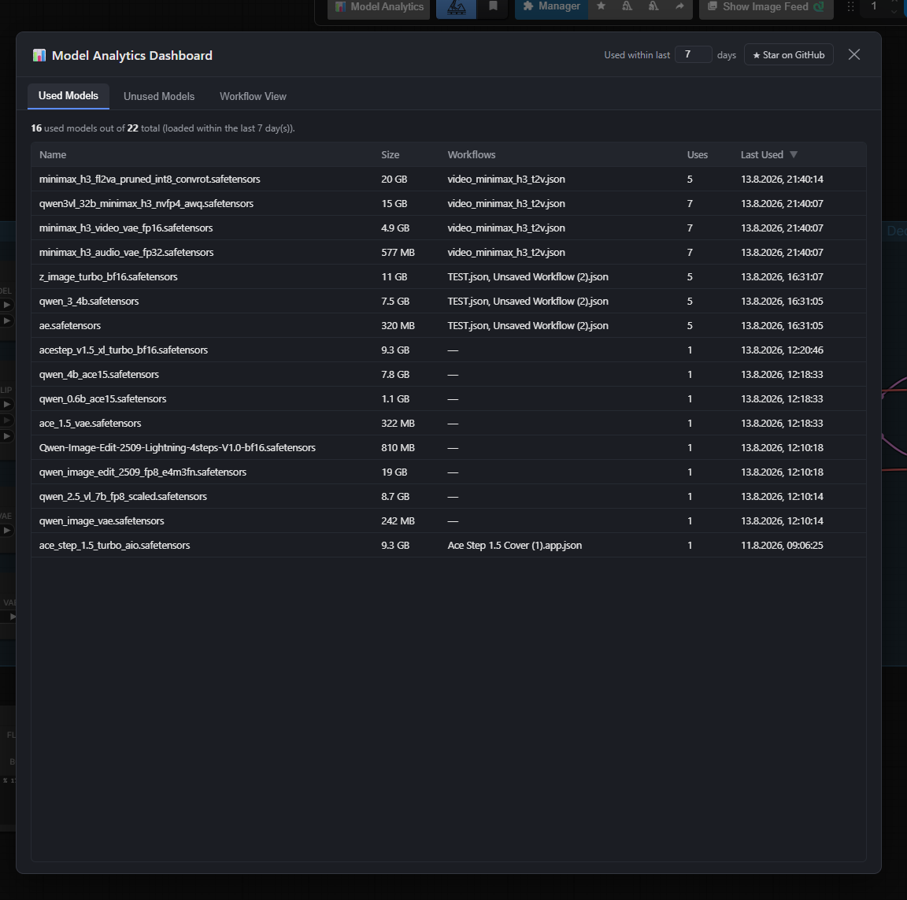
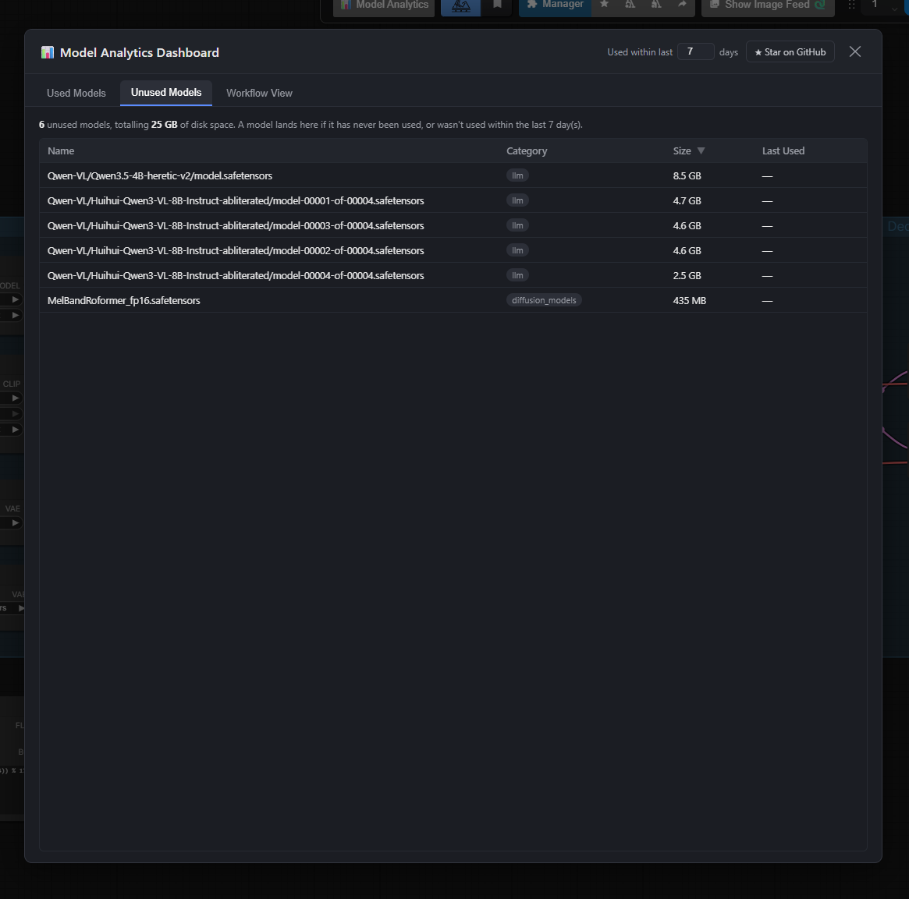

# ComfyUI Model Analytics Dashboard

A lightweight, read-only custom node for ComfyUI that helps you figure out which models you actually use and which ones are just wasting disk space.

https://github.com/user-attachments/assets/7dfe80a5-28de-42bc-8989-bc9301c4389b

<table>
  <tr>
    <td></td>
    <td></td>
  </tr>
  <tr>
    <td align="center"><sub>Used Models</sub></td>
    <td align="center"><sub>Unused Models</sub></td>
  </tr>
</table>

## Why I made this

I kept accumulating gigabytes of checkpoints, LoRAs, and UNets without knowing if they were still tied to any workflow or even loaded recently. This extension scans your setup and gives you a clear dashboard.

## What it does

* **Disk Scan:** Walks through all known model directories on your disk to find files.
* **Workflow Parser:** Checks your saved workflow JSON files to see which models are referenced.
* **Live Tracking:** Hooks into model loading to record what actually gets loaded at runtime, and also notes which models a queued prompt names - so cached models and GGUF loaders are not missed.
* **Recency-Based Categorization:** A model counts as "Used" if it's referenced by any saved workflow, *or* it was loaded or queued within the last 7 days (configurable in the dashboard, and can be turned off entirely so any past load counts no matter how old). No permanent flags - outside of workflow references, a model quietly moves back to "Unused" once it's been idle long enough, and comes back the moment it's used again.
* **Extra Model Paths:** Folders declared in `extra_model_paths.yaml` are scanned too, even on another drive. Files ending in `.disabled` get their own tab.
* **Strictly Read-Only:** It only analyzes data. No files will ever be deleted or modified automatically.
* **Clean Dashboard:** Opens from the **Extensions** menu or from a button in ComfyUI's top action bar (legacy menu: a button in the menu). Tabs for used models, dead weight, disabled files, workflow breakdowns, and settings.
* **Theme-Aware Design:** The dashboard uses ComfyUI's own design tokens, so it matches Dark, Light and every other ComfyUI theme. It can also be switched independently to Dark or Light (built from CSS system colours, no hard-coded palette) without changing the surrounding ComfyUI interface.
* **Multiple Languages:** English, German, Simplified Chinese, Traditional Chinese, Japanese, and Korean are supported. Automatic mode follows ComfyUI's language; a manually selected language stays selected.
* **In-Dashboard Settings:** Change the language, dashboard theme, used/unused time window, size units (GiB/GB), row density, date format, default tab, and GitHub star banner directly in the dashboard Settings tab. Every preference is also registered in **Settings → Model Analytics** and stored by ComfyUI, so it survives restarts. The time window used to live in the browser's localStorage; an existing value is carried over once automatically.

## Installation

1. Go to your ComfyUI custom nodes folder:

```bash
cd ComfyUI/custom_nodes/
```

2. Clone the repository:

```bash
git clone https://github.com/Bennowan/ComfyUI-Model-Analytics.git
```

3. Restart ComfyUI and open **Extensions → Model Analytics** (or click the chart button in the top action bar).

## Support

If this saved you some disk-space headaches, a ⭐ on GitHub helps other people find it.

## License

Non-commercial. Check the LICENSE file for details.
