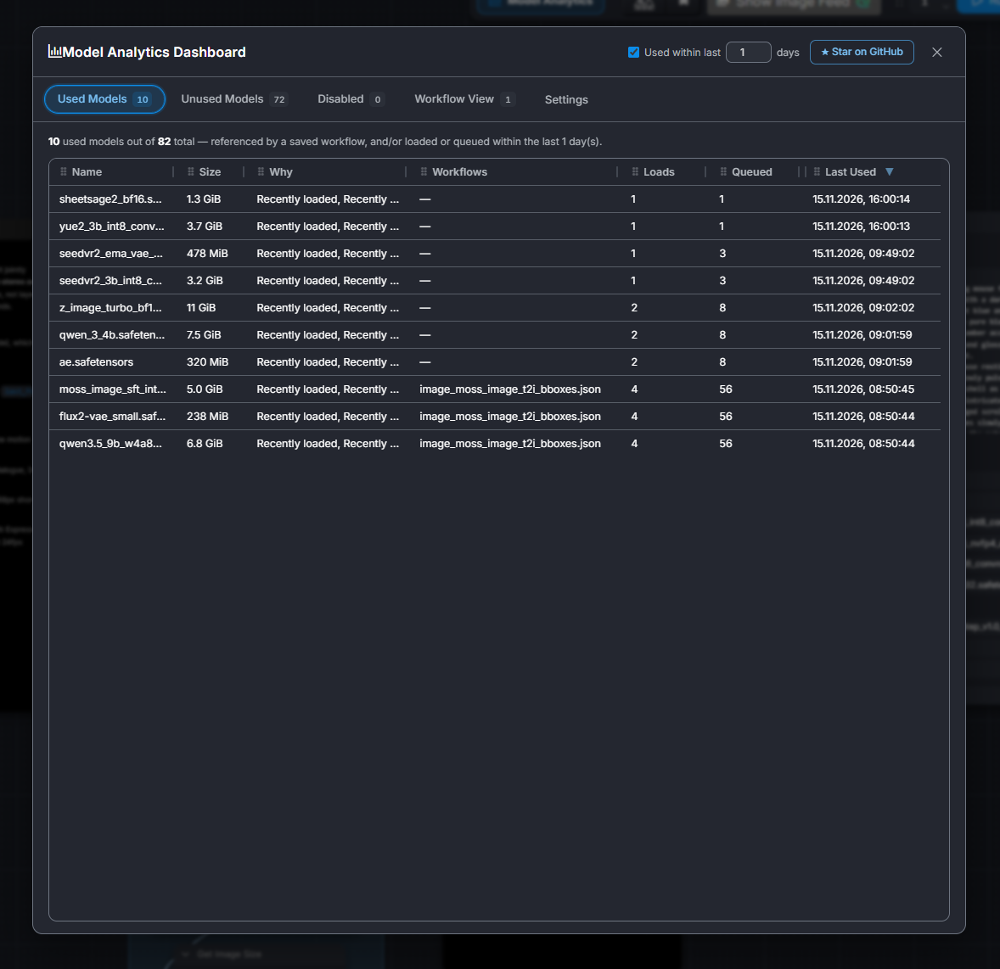
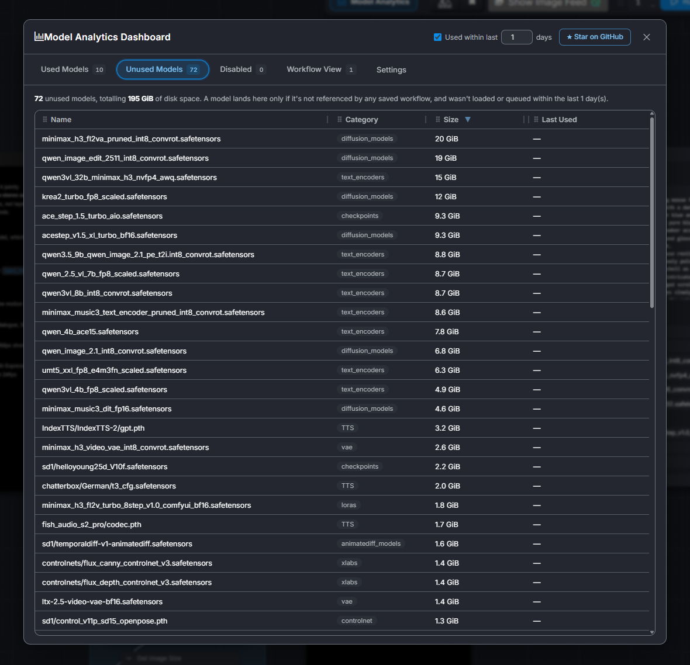

# ComfyUI Model Analytics Dashboard

A local ComfyUI analytics extension for understanding model usage and discovering which installed Custom Node packages appear in started workflows or have completed successful node executions. A shared time-window and usage-source filter applies to both Models and Custom Nodes. Model files, workflows and installed packages are never modified by the analytics features.

[Demo Video](https://github.com/user-attachments/assets/7b61a5cc-5f34-4b0c-939c-dd8b7401bfe6)


<table>
  <tr>
    <td></td>
    <td></td>
  </tr>
  <tr>
    <td align="center"><sub>Used Models</sub></td>
    <td align="center"><sub>Unused Models</sub></td>
  </tr>
</table>

## Why I made this

I kept accumulating gigabytes of checkpoints, LoRAs, and UNets without knowing if they were still tied to any workflow or even loaded recently. This extension scans your setup and gives you a clear dashboard.

## What it does

- **Disk Scan:** Walks through all known model directories on your disk to find files.
- **Workflow Parser:** Checks your saved workflow JSON files to see which models are referenced.
- **Live Tracking:** Hooks into model loading to record what actually gets loaded at runtime, and also notes which models a queued prompt names - so cached models and GGUF loaders are not missed.
- **Recency-Based Categorization:** A model counts as "Used" if it's referenced by any saved workflow, or it was loaded or queued within the last 7 days. The period is configurable and can be disabled entirely so any past load counts regardless of age. No permanent flags - outside of workflow references, a model quietly moves back to "Unused" once it's been idle long enough, and comes back the moment it's used again.
- **Extra Model Paths:** Folders declared in `extra_model_paths.yaml` are scanned too, even on another drive. Files ending in `.disabled` get their own tab.
- **Non-Destructive:** Model assets, workflow files and installed custom-node packages are only inspected; the extension does not alter them. Analytics history and preferences are stored locally.
- **Clean Dashboard:** Opens from one clearly placed `📊 Analytics` entry point: a styled button in ComfyUI's legacy menu, or a custom-styled native action-bar button when the modern menu is enabled. The dashboard has three top-level sections: Models, Custom Nodes, and Settings. Existing model tabs remain available inside Models. The global header controls filter both model files and Custom Node packages by recency and usage source (Frontend, API, or Unknown).
- **Theme-Aware Design:** The dashboard follows ComfyUI by default. You can also select a palette from ComfyUI's palette registry for the dashboard only, or use the optional advanced appearance editor. Palette colours are read from ComfyUI's theme definitions and applied locally; the global interface and workflow canvas are not changed.
- **Multiple Languages:** English, German, Simplified Chinese, Traditional Chinese, Japanese, and Korean are supported. Automatic mode follows ComfyUI's language; a manually selected language stays selected.
- **In-Dashboard Settings:** General Settings contain language, appearance, density, date format and the default top-level section. Model Analytics Settings retain the model recency window, size units and default model tab. Custom Node Analytics Settings control successful-execution tracking and saved-workflow scanning. UI preferences are stored by ComfyUI. The GitHub star banner appears on first install and can be dismissed permanently with its close button. Table columns can be resized and rearranged by dragging their headers; each table remembers its layout locally. Vertical table scrolling uses a themed scrollbar and horizontal overflow is suppressed.

## Installation

1. Go to your ComfyUI custom nodes folder:

```bash
cd ComfyUI/custom_nodes/
```

2. Clone the repository:

```bash
git clone https://github.com/Bennowan/ComfyUI-Model-Analytics.git
```

3. Restart ComfyUI and use the single `📊 Analytics` entry point: the native action-bar button when the modern ComfyUI menu is enabled, or the styled menu button in legacy-menu mode.

## Support

If this saved you some disk-space headaches, a ⭐ on GitHub helps other people find it.

## License

ComfyUI-Model-Analytics is licensed under the **Bennowan Community Non-Commercial License (BCNCL) v1.0**.

- **Non-commercial use only:** Commercial use, monetization, paid distribution, and other forms of financial gain are prohibited. Commercial use requires separate written permission from the copyright holder.
- **Attribution required:** Original copyright notices and credits must be preserved.
- **No independent mirrors:** Unchanged or substantially identical copies may not be published or maintained as separate projects.
- **Community contributions welcome:** Development forks and contributions to the official repository are permitted under the license terms.

The official project is maintained by **Bennowan**:

[github.com/Bennowan/ComfyUI-Model-Analytics](https://github.com/Bennowan/ComfyUI-Model-Analytics)

See the [LICENSE](./LICENSE) file for the complete terms.

## Shared Usage Filters

The dashboard header contains one shared **Used within the last X days** control and one **Usage Source** filter. They apply to both the Models and Custom Nodes sections. Select All Sources, Frontend, API, or Unknown. Turning off the time-window checkbox includes all retained history.

For Models, source-tagged prompt/model pairs are recorded when ComfyUI's execution worker starts a prompt. The existing saved-workflow references remain a separate signal. Legacy model-history entries without source or timestamp remain Unknown and are not assigned invented dates.

For Custom Nodes, the same started-prompt event records installed external packages only when at least one of their node types is reachable upstream from a validated output target in ComfyUI's `outputs_to_execute` list. The tracker reads this list from the fifth field of the ComfyUI `PromptQueue` item, then follows actual `[node_id, output_index]` links backwards through node inputs. A package that appears only in a disconnected or orphaned side chain is therefore not attributed to that run. Packages are deduplicated within each prompt, so several participating nodes from one package produce one package/prompt match.

A prompt's source is classified using ComfyUI's frontend metadata or an explicit/API request marker; unsupported identifiers remain Unknown. If ComfyUI does not provide validated output targets, custom-package prompt attribution is skipped rather than inferred from all prompt nodes.

**Active graph participation and successful execution are different measurements.**

For a package to appear as part of a started prompt, at least one of its nodes must be reachable upstream from one of that run’s validated output targets. A connected chain that does not lead to a requested output is ignored, even if its nodes are linked to one another.

The package execution counter is stricter still: it increases only when ComfyUI calls the node’s actual `FUNCTION`, the final per-node result is successful, and the output cache confirms that the result was not served from cache.

A `SUCCESS` status by itself is not sufficient, because ComfyUI can also report success for cached results or steps whose lazy inputs prevented the node function from running.

The separate successful-execution counter increases only when ComfyUI's `pre_execute_cb` proves the node's `FUNCTION` was actually invoked, the final per-node result is successful, and the output cache confirms a cache miss. The callback is observed through ComfyUI's `get_output_data` path.

Lazy nodes whose function was blocked, failed nodes, and cached nodes do not increment the counter. Nodes outside the requested output graph cannot increment it because ComfyUI does not schedule them.

Historical prompt events written before 1.5.7 did not preserve output targets, so they are retained as `unverified_legacy` for auditability but excluded from new package source/time usage filters. Historical execution counters remain intact.

ComfyUI 0.43.0 forwards the `Comfy-Usage-Source` request header into prompt `extra_data` when a client supplies it. The built-in frontend identifies itself as `comfyui-frontend`.

An external API client is classified as API when it sends `api` or `comfyui-api` as its source marker. Calls without a marker are classified from the request itself: the ComfyUI web interface attaches `extra_data.extra_pnginfo`, while a plain external `/prompt` request does not. Prompts with explicit but unrecognized markers remain Unknown.

## Custom Node Analytics

The **Custom Nodes** section works at the installed-package level. It does not render individual node classes. This keeps the dashboard responsive even when a ComfyUI installation registers many custom node types.

Each package is also classified as **UI extension only**, **Node package**, **UI + node package**, or **Other / unclassified**. UI-only extensions (for example, a dashboard extension that registers a ComfyUI frontend but no workflow nodes) are excluded from the used/unused workflow-node package lists.

This classification uses ComfyUI’s registered frontend extension directories (`EXTENSION_WEB_DIRS`) and its active node registry.

The four package-level views are:

- **Used Packages:** Installed, enabled packages that are reachable from a validated output target in a started prompt within the selected time window/source, or have a successful execution within the selected period when All Sources is selected. The table keeps the successful, non-cached execution count separate from active-graph prompt presence.
- **Unused Packages:** Installed, enabled packages with no matching active-output-graph prompt event or successful execution in the selected time window/source. This does not prove they were never used before tracking began. Packages that are not currently registered are clearly marked.
- **Disabled Packages:** Packages whose custom-node folder or file uses ComfyUI's `.disabled` suffix.
- **Workflows:** Readable saved workflow JSON files that contain at least one recognized node type from an installed external custom-node package. Each workflow is listed once with the matching package names and counts.

All four views use the same data-table implementation as Model Analytics. Columns can be resized, reordered by dragging their headers, and sorted where applicable. Column layouts are stored separately for each package table in ComfyUI's settings.

### How Collection Works

**External packages only.**

Candidate packages are discovered inside the directories returned by ComfyUI's `folder_paths.get_folder_paths("custom_nodes")`.

A registered node type is attributed using ComfyUI’s own registration metadata first (`RELATIVE_PYTHON_MODULE` and `LOADED_MODULE_DIRS`), with its Python module path as a conservative fallback. This also handles classes re-exported from shared modules more reliably.

Built-in ComfyUI nodes and classes that cannot be attributed unambiguously are excluded. Node classes are retained only in the backend's in-memory lookup needed for package attribution; individual node rows are not sent to the browser or rendered in the dashboard.

**Successful executions.**

The extension wraps ComfyUI's per-node `execution.execute` entry point and its `get_output_data` callback.

The callback is the proof that ComfyUI is about to invoke the node's actual `FUNCTION`; a successful final result and a confirmed cache miss are then required before its package count increases. Asynchronous/dynamic calls retain this proof until their final success.

Package totals are stored directly; the history format does not write one history entry per node class. Queue submission, graph presence alone, lazy-blocked functions, failed steps and cached results are not treated as successful executions.

The registry-to-package lookup is built once and reused until ComfyUI’s registration state changes. If ComfyUI changes this internal execution interface, tracking may become unavailable; the hook fails open and must never interrupt generation.

**Workflow presence.**

Saved workflow files are scanned using the existing workflow-directory discovery logic.

Both standard graph JSON (`nodes[].type`) and API prompt JSON (wrapped `prompt.*.class_type` or direct node-id mappings) are recognized, including nested node groups where readable.

Only workflows containing recognized external package node types are returned. Disabled packages cannot normally be resolved from ComfyUI's active node registry, so their references are not included unless ComfyUI registers them.

If the workflow directory is unavailable or scanning is disabled, the view reports that state instead of displaying a misleading zero. Workflow JSON files are parsed again only when the set of files or their modification metadata changes.

### Data Storage and Settings

Package execution history, source-aware started-prompt events and the two backend collection settings are stored in `custom_node_history.json` under ComfyUI's user directory. This remains separate from `model_history.json`.

Existing schema-v1 per-node history is migrated by summing its recorded execution counts per package; schema-v2/v3 package totals are preserved.

Pre-1.5.7 prompt events are retained with `scope: "unverified_legacy"` because older versions did not store the validated output targets and cannot prove whether a package was on the executing graph. Those events are excluded from usage aggregates until fresh validated observations are recorded.

New writes persist package-level totals and deduplicated active-output-graph prompt events only; model data is not changed.

Execution updates are buffered for up to one second before being written, and pending changes are flushed when the process exits normally. An abrupt process termination can lose the most recent unflushed interval. UI preferences and package-table layouts are stored in ComfyUI's settings system.

The package inventory is cached in memory after its initial scan. The extension checks lightweight package, registry and workflow-file fingerprints; package discovery and workflow JSON parsing are repeated only when those inputs change.

New successful executions update the cached package counters directly without rebuilding the inventory. The dashboard keeps its last good snapshot when the modal is closed and reopened, so “Loading data…” is shown only before the first successful load or after an explicit settings change.

Execution counters begin when tracking first records a package. Historical executions cannot be reconstructed beyond the migrated local history. If tracking is disabled, no new execution counts are recorded; re-enabling tracking resumes collection. Workflow scanning can be disabled independently.

## Dashboard Structure

- **Models:** Existing Model Analytics, including Used, Unused, Disabled and Workflow views, source filtering, recency controls and existing appearance/table behavior.
- **Custom Nodes:** Used Packages, Unused Packages, Disabled Packages and Workflows. No individual node-type list or separate overview/not-recorded view is shown.
- **Settings:** General Settings, Model Analytics Settings and Custom Node Analytics Settings, kept in separate sections.

## Tests

Run the Python and JavaScript test suites from the repository root:

```bash
python -m unittest discover -s tests -v
node --test tests/**/*.test.mjs
node tests/check_i18n.mjs
```

The custom-node tests cover package-level storage and schema migration, external-package attribution, built-in-node exclusion, workflow package aggregation, cached registry lookup, successful-only execution tracking, validated-output graph traversal (including connected orphan branches), legacy unverified-event handling, source-tagged package attribution and recency filtering.
